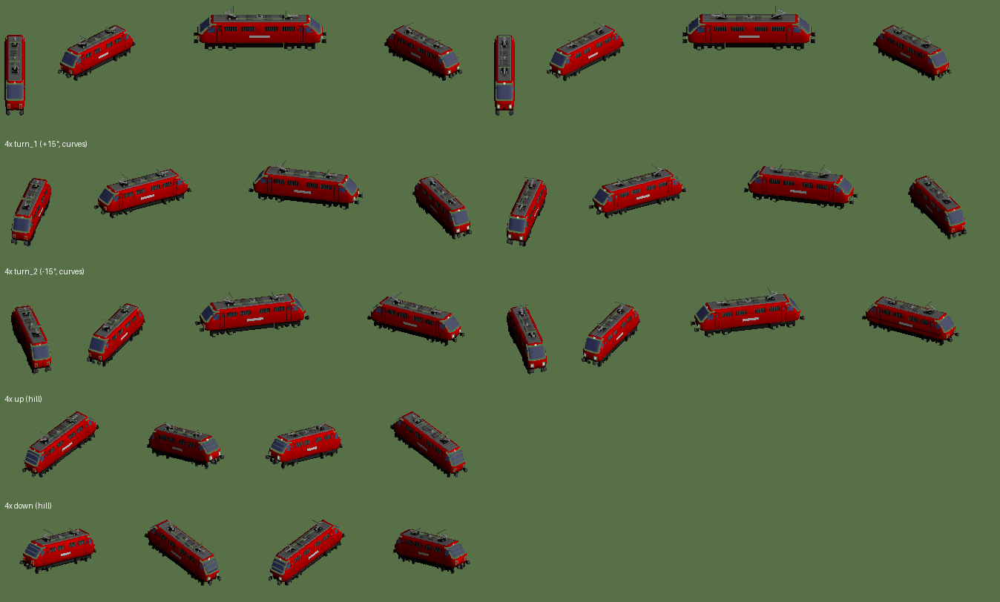

# Pünktlich

Swiss trains and buses for [OpenTTD](https://www.openttd.org): SBB, BLS, RhB, MGB, PostAuto and more. They're rendered from voxel models at 1×, 2× and 4× zoom in 32bpp with company-colour masks.



**Status:** early. SBB Re 460, EW IV coaches with Bt control car, RBDe 560 Domino, FV-Dosto (IR 100, IC 200) and Giruno multiple units, SBB Cargo Eanos and Sgns wagons with cargo loads; on metre gauge the RhB Ge 4/4 III with EW IV coaches, the MGB HGe 4/4 II rack locomotive (rack track needs a rack engine) and the Glacier Express panorama coaches; PostAuto Citaro and Citaro G buses. Two GRFs: `puenktlich.grf` (vehicles) and `puenktlich_tracks.grf` (metre-gauge and rack railtypes with their own crossings, bridges, tunnels and depots; load it before the vehicles). See [docs/COMPLETENESS.md](docs/COMPLETENESS.md).

## Build

Requirements: [uv](https://docs.astral.sh/uv/), Go ≥ 1.22, git. For testing you also need OpenTTD ≥ 15.

```sh
make setup        # python deps + gorender/cargopositor into .tools/bin
make build        # -> build/puenktlich.grf + build/puenktlich_tracks.grf (metre gauge)
make install      # copy to OpenTTD's newgrf folder (~/.local/share/openttd/newgrf; Windows: Documents/OpenTTD/newgrf)
ewgrf)
make test lint
```

## How it works

```
data/*.yaml ─┐
recipe.py ──→ .vox ──→ GoRender 1×/2×/4× (8bpp, 32bpp, mask) ──→ NML ──→ nmlc ──→ puenktlich.grf
```

- Every vehicle is a YAML file (`data/vehicles/`) plus a **voxel recipe** (`models/`). The recipe is a short Python program built from a parts library: shells, noses, bogies, pantographs. That makes models diffable and parametric, and easy for AI assistants to write and iterate on. Hand-made MagicaVoxel `.vox` files work too.
- `uv run pk new <operator> <id> --kind …` starts a vehicle from a stub that already builds.
- `uv run pk preview <id>` renders a contact sheet with all views, zooms and the colour mask for review (`--draft` for a quick look).
- Completeness is tracked against official fleet lists in `data/reference/`.

More detail: [Architecture](docs/ARCHITECTURE.md) · [Scale](docs/SCALE.md) · [Style](docs/STYLE.md) · [Agent guide](CLAUDE.md)

## Credits
- [GoRender](https://github.com/mattkimber/gorender) and [Cargopositor](https://github.com/mattkimber/cargopositor) by Matt Kimber (MIT). The render manifest, scale and sprite-offset formula are adapted from [Timberwolf's Trains](https://github.com/mattkimber/timberwolfs_trains).
- [NML](https://github.com/OpenTTD/nml) by the OpenTTD team.

## Licence
GPL-2.0-only. See [LICENSE](LICENSE).
